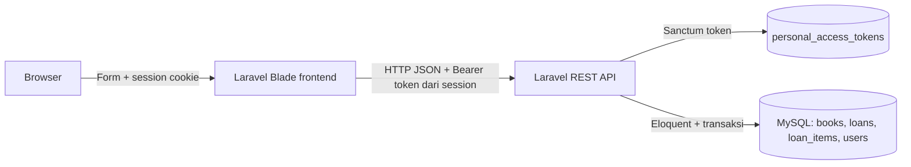

# Kontrak API Perpustakaan

Base URL lokal: `http://127.0.0.1:8000/api`  
Format: JSON UTF-8. Seluruh route buku dan peminjaman memerlukan `Authorization: Bearer <token>` dari Sanctum. Register dan login bersifat publik.

## Endpoint

| Method | Endpoint | Auth | Request utama | Sukses | Error utama |
|---|---|---:|---|---:|---|
| POST | `/auth/register` | Tidak | `name`, `email`, `password`, `password_confirmation` | 201 | 422 validasi/email terpakai |
| POST | `/auth/login` | Tidak | `email`, `password` | 200 | 422 kredensial salah |
| POST | `/auth/logout` | Ya | — | 200 | 401 token tidak ada/tidak valid |
| GET | `/books` | Ya | Query `genre`, `sort=title\|stock`, `direction=asc\|desc` | 200 | 401/422 query invalid |
| POST | `/books` | Ya | `title`, `genre`, `stock` | 201 | 401/422 validasi |
| DELETE | `/books/{id}` | Ya | — | 200 | 401/404 |
| GET | `/loans` | Ya | — | 200 | 401 |
| POST | `/loans` | Ya | `borrower_name`, `phone_number`, `due_date`, `idempotency_key`, `items[]` | 201 | 401/422 stok atau input invalid |

### Contoh peminjaman

```json
{
  "borrower_name": "Ayu Putri",
  "phone_number": "081234567890",
  "due_date": "2026-12-01",
  "idempotency_key": "a9436ff9-48e5-4916-8fd0-96fb67e5ab32",
  "items": [
    { "book_id": 1, "quantity": 2 },
    { "book_id": 3, "quantity": 1 }
  ]
}
```

Contoh respons `201`:

```json
{
  "message": "Peminjaman berhasil dicatat.",
  "data": {
    "id": 1,
    "borrower_name": "Ayu Putri",
    "phone_number": "081234567890",
    "due_date": "2026-12-01T00:00:00.000000Z",
    "idempotency_key": "a9436ff9-48e5-4916-8fd0-96fb67e5ab32",
    "items": [
      { "book_id": 1, "book_title": "Laut Bercerita", "quantity": 2 }
    ]
  }
}
```

Semua error validasi memakai status `422` dan objek `errors` per field. Peminjaman mengunci baris stok, memvalidasi seluruh judul terlebih dahulu, lalu menyimpan transaksi dan mengurangi stok dalam satu transaksi database. Jika satu judul tidak cukup stok, seluruh transaksi dibatalkan. Kunci UUID idempotensi yang sama membuat konfirmasi ulang mengembalikan transaksi yang sudah tercatat tanpa mengurangi stok lagi. `loan_items.book_title` menyimpan snapshot agar histori tetap bisa dibaca setelah buku dihapus.

## Hubungan sistem


